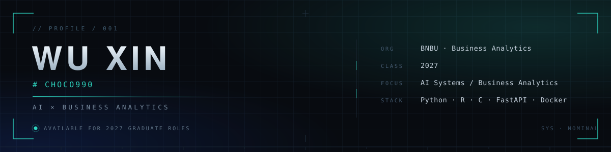

<div align="center">
  
</div>

<div align="center">
  
</div>

<br/>

## `> whoami`

```yaml
name       : WU Xin  (CHOCO)
program    : BSc Business Analytics @ BNBU
class_of   : 2027
focus      : AI application engineering × business analytics
toolkit    : Python · R · C · SQL · FastAPI · Docker
currently  : turning business questions into systems that run at 7 a.m. without me
```

Two things interest me equally: **what the number actually means**, and **whether the thing that produced it can be shipped**. Most analytics work stops at the slide; most engineering work never asks what the metric is for. I try to sit in the gap — read the data, decide what matters, then build and deploy the pipeline that keeps saying it.

<br/>

## `> stack --list`

| LAYER | WHAT I ACTUALLY USE |
| :--- | :--- |
| **LANG** |       |
| **AI** |    |
| **INFRA** |     |
| **DATA** |    |

<br/>

## `> analytics`

| DOMAIN | WORKING KNOWLEDGE |
| :--- | :--- |
| **MODELLING** | regression · hypothesis testing · classification · forecasting |
| **TOOLING** | R · Python (pandas) · SQL · spreadsheet modelling |
| **DELIVERY** | metric definition → dashboard → a decision someone can actually act on |

The half of the work that no commit history shows: framing the question, choosing the metric, and knowing when a result is noise.

<br/>

## `> builds`

### `01` &nbsp;AI Learning Assistant · [source →](https://github.com/CHOCO990/AI_Learning_Assistant)

> A full-stack AI agent that generates homework code, essays, slide decks and cheat sheets — containerised and shipped to a public cloud endpoint.

| LAYER | IMPLEMENTATION |
| :--- | :--- |
| **runtime** | FastAPI backend serving a browser UI, SQLite metadata store, artifacts persisted outside the container |
| **inference** | Qwen-compatible model API, per-user keys encrypted at rest |
| **delivery** | Docker Compose → Aliyun ECS → Nginx reverse proxy with HTTPS and an access-control layer |
| **hardening** | secrets injected via env, never in source · security-group allowlist · `/health` probe before traffic |
| **pipeline** | rewrote the report-generation instruction layer so the agent emits structured, rubric-aligned output |

<br/>

### `02` &nbsp;Enterprise Mail → WeChat Digest · [source →](https://github.com/CHOCO990/email-assistant-bot)

> Runs unattended every morning: reads an enterprise IMAP inbox, merges the noise, and pushes a classified briefing to personal WeChat.

| LAYER | IMPLEMENTATION |
| :--- | :--- |
| **sync** | IMAP UID watermark — only new mail is processed, nothing is re-summarised or double-pushed |
| **logic** | 8-way classifier (security · exams · deadlines · recruiting · scholarships · …) + dedup and merge of withdrawn or corrected notices |
| **output** | dual channel — SMTP digest in HTML + plain text, plus a stdout summary captured by automation |
| **ops** | credentials env-only · JSON state file · cron-scheduled, failure-tolerant, zero manual touch |

<br/>

### `03` &nbsp;Codex Pet · Packaged Bundle · [source →](https://github.com/CHOCO990/yuexinmiao-2-codex-pet)

> A distributable desktop-companion package for Codex — skill manifest, animation assets and a one-shot installer, so someone else can get it running without asking me.

| LAYER | IMPLEMENTATION |
| :--- | :--- |
| **packaging** | `SKILL` manifest + `assets/` + install script, versioned |
| **content** | sprite animation set with rendered previews |
| **docs** | bilingual setup guide + animation preview |

<br/>

## `> principles`

> **Ship the boring version first.** Instrument it, watch it fail for a week, then automate the parts that actually hurt.
>
> **Secrets never enter the repository.** Env vars and a `.env.example`. Nothing else.
>
> **If it cannot run unattended, it is not finished.** A pipeline that needs me at 7 a.m. is a to-do list, not a system.
>
> **Boring, unglamorous reliability is the feature.** Nobody thanks you for the digest at 7:00 that always arrives — that is the point.

<br/>

## `> contact`

<div align="center">

[](https://github.com/CHOCO990)
[](mailto:your@email.com)

<sub>Open to 2027 graduate roles & internships across AI application engineering, business analytics and data products.</sub>

</div>

<br/>

<div align="center">
  
  
</div>
